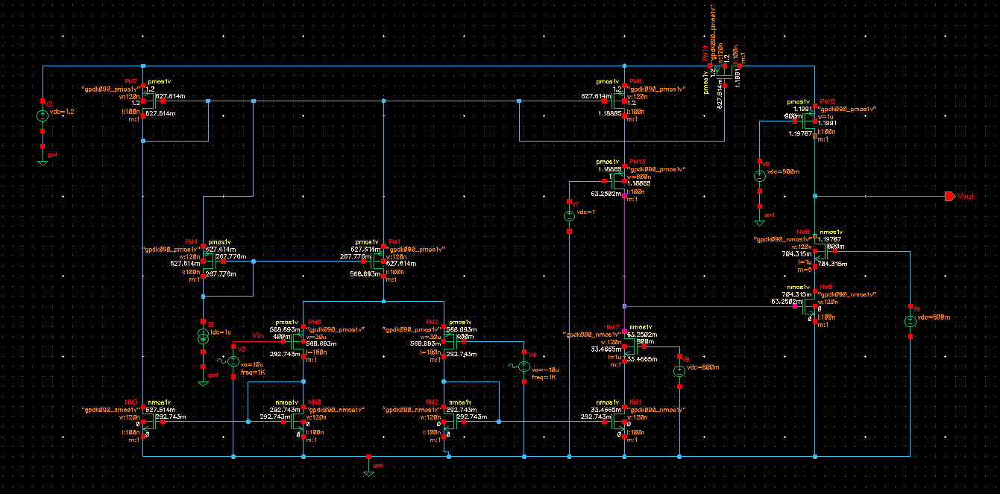
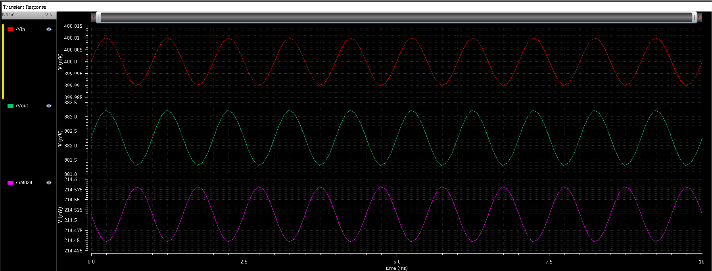
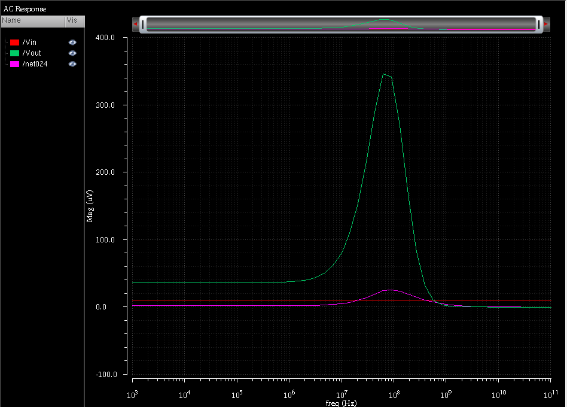
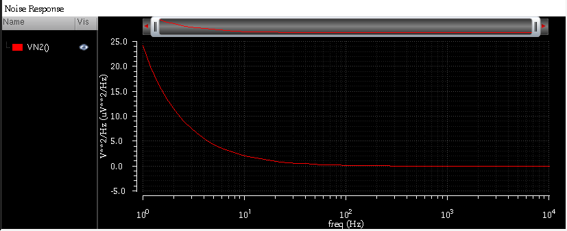
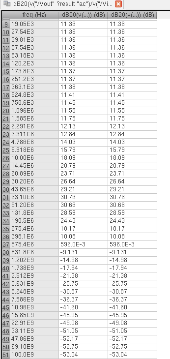

# Two-Stage CMOS Biopotential Amplifier

**Author: Srinnath Krishnan**

Design and simulation of a two-stage CMOS amplifier for low-amplitude biopotential signals using Cadence Virtuoso Spectre in a gpdk 90 nm CMOS design environment.

## Project overview

The design uses a first-stage operational transconductance amplifier (OTA) followed by a cascode gain stage. The work focuses on voltage gain, frequency response, transconductance efficiency, common-mode rejection, noise, and power consumption.

## Repository contents

```text
cmos-biopotential-amplifier/
├── README.md
├── .gitignore
├── images/
│   ├── two_stage_cmos_amplifier_schematic.png
│   ├── transient_response.png
│   ├── ac_response.png
│   ├── common_mode_ac_response.png
│   ├── noise_response.png
│   └── ac_gain_data.png
└── docs/
    ├── design-methodology.md
    └── simulation-results.md
```

## Circuit schematic



## Simulation results

### Transient response



### AC response



### Common-mode AC response


### Noise response



### AC gain data



## Design metrics

| Metric | Value |
|---|---:|
| Midband voltage gain | 39.6 dB |
| Linear voltage gain | Approximately 95.5 V/V |
| Bandwidth | 45 MHz |
| Current | 398 nA |
| Power consumption | 5 nW |
| Transconductance efficiency, $g_m/I_D$ | 35.9 V$^{-1}$ |
| CMRR | 51.38 dB |
| First-stage tail current | Approximately 6 µA |
| First-stage input-pair transconductance | Approximately 82 µS |
| First-stage $g_m/I_D$ | Approximately 27 V$^{-1}$ |
| First-stage open-loop gain | Approximately 31.8 dB |
| First-stage unity-gain frequency | Approximately 7 GHz |

## Technical documentation

- [Design methodology](docs/design-methodology.md)
- [Simulation results and calculations](docs/simulation-results.md)

## Author

**Srinnath Krishnan**
